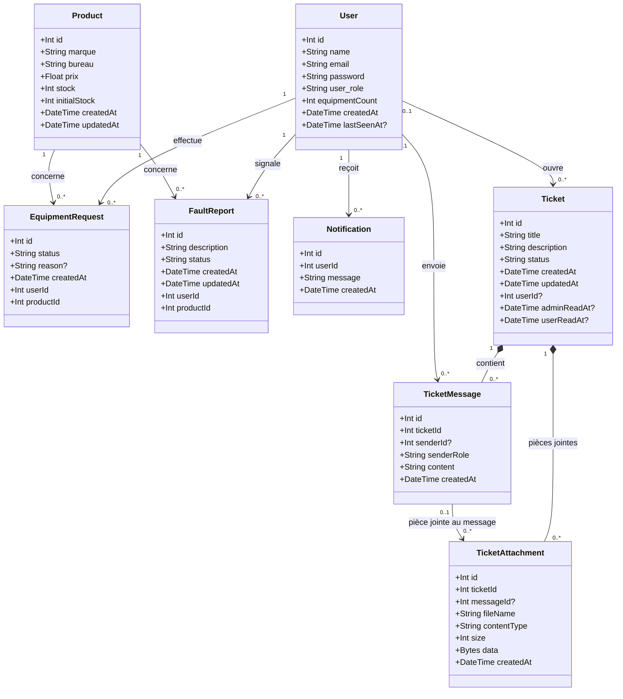
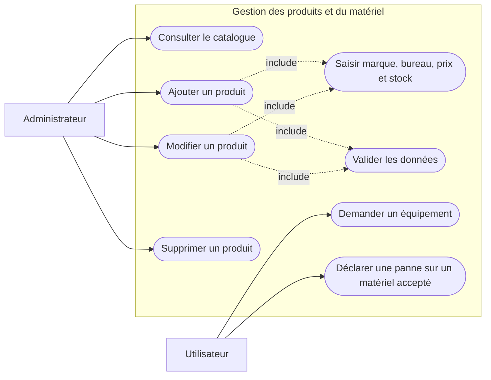

# Diagrammes UML — application de gestion

Ces diagrammes Mermaid s'affichent dans l'aperçu Markdown de VS Code et sur GitHub. Le diagramme de classes représente les modèles actuels de la base de données. Les sources PlantUML sont également disponibles dans le même dossier.

## Diagramme de classes

## Diagramme de cas d'utilisation

Le diagramme comprend les huit modèles actuels du schéma Prisma : `User`, `Product`, `EquipmentRequest`, `FaultReport`, `Notification`, `Ticket`, `TicketMessage` et `TicketAttachment`. Les demandes d'équipement sont liées au modèle `Product`. La création d'un produit est réservée à un administrateur authentifié. À la création, le stock initial est également enregistré dans `initialStock`. Une déclaration de panne concerne un matériel pour lequel la demande de l'utilisateur a été acceptée.
